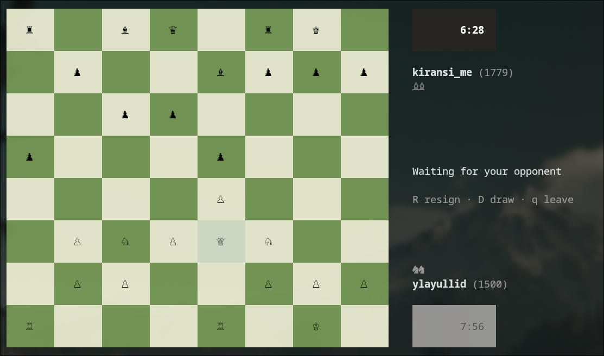

# kingsh

Chess in your terminal. Play a friend on the same keyboard or a real opponent on [lichess](https://lichess.org) with style.



# Features

- All chess rules, including en passant!
- All draws conditions are considered.
- Clocks with increment, any time control (`-tc 3+2`, `-tc 10+0`, ...)
- Online play on lichess with resign, draw offers and automatic reconnecting

## Install

**Download a binary** from the
[latest release](https://github.com/tosterabgx/kingsh/releases/latest), then:

```sh
chmod +x kingsh-linux-amd64
./kingsh-linux-amd64
```

**Or install with Go** (1.27.2 or newer):

```sh
go install github.com/tosterabgx/kingsh/cmd/kingsh@latest
```

## Play locally

```sh
kingsh             # 10 minutes each
kingsh -tc 3+2     # 3 minutes + 2 seconds per move
```

## Play online on lichess

1. Create a lichess API token with the **board:play** permission:
   [create token](https://lichess.org/account/oauth/token/create?scopes[]=board:play&description=kingsh)
2. Put it in your environment and start a game:

```sh
export LICHESS_TOKEN=lip_...
kingsh online               # rated 10+0
kingsh online -tc 15+10     # another time control
kingsh online -casual       # unrated
```

## Terminal setup

kingsh draws the pieces with the Unicode chess symbols (♔♕♖♗♘♙ ♚♛♜♝♞♟), so it needs:

- **A truecolor terminal**
- **A font with the chess symbols.**

Tested on kitty.

## License

MIT licensed
